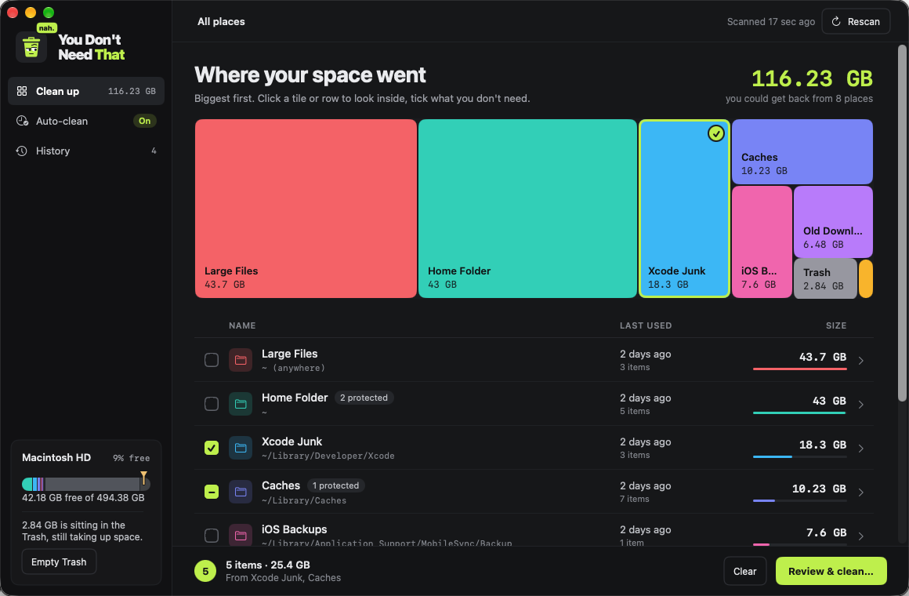
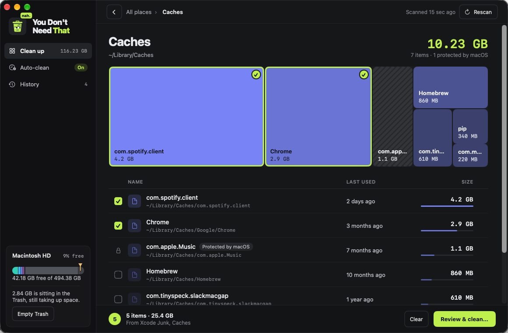
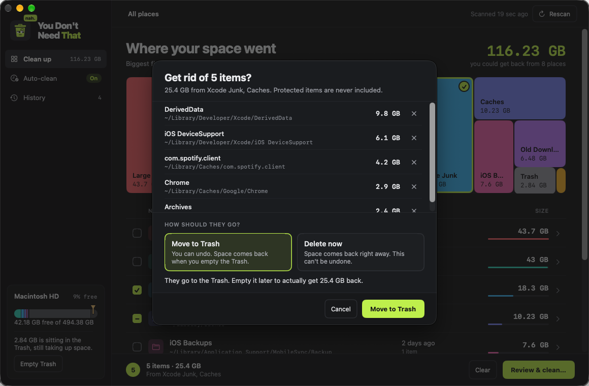
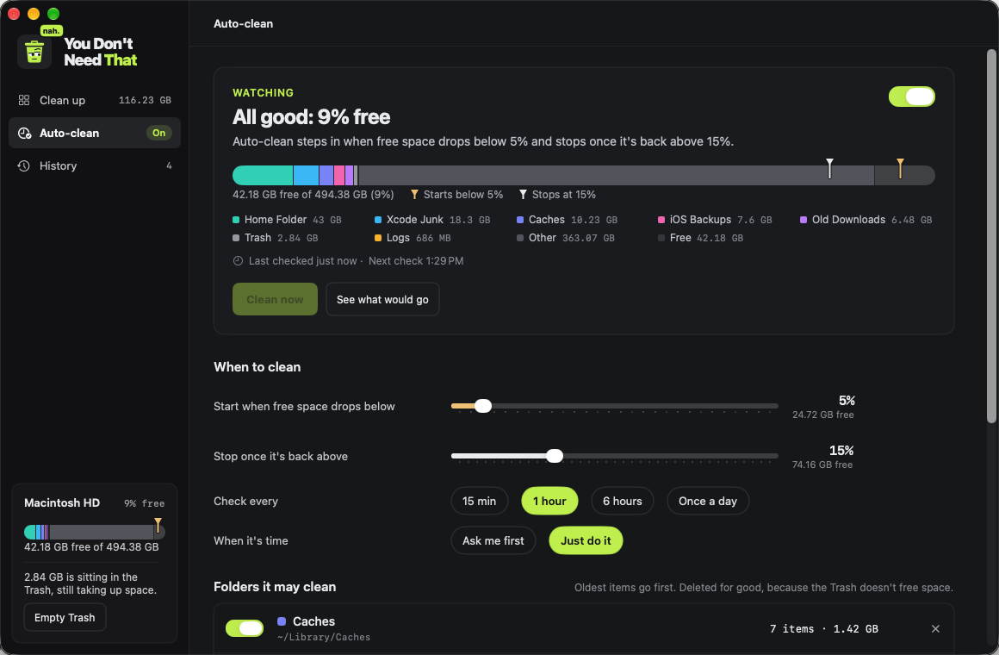
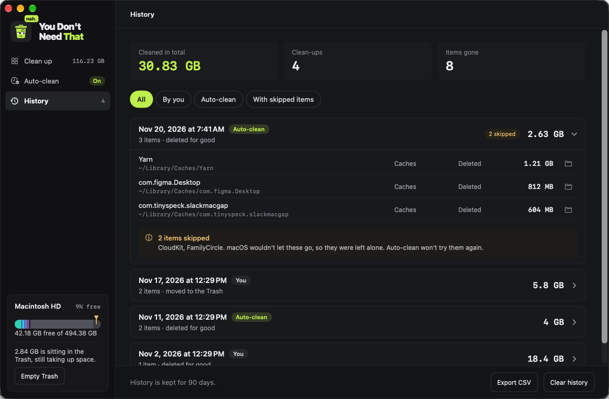
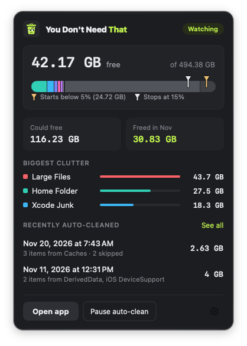

# You Don't Need That

A macOS disk cleaner with opinions. See where your space went, drill in, tick what you don't need, and get it back.
Or let it clean up on its own when space runs low.



## What it does

**Clean up.** Your home folder, scanned into places like Large Files, Xcode Junk, Caches, Old Downloads and iOS Backups,
biggest first. Click a tile or row to look inside a folder; tick what can go. Picks stay in the basket while you browse
other places. Things macOS protects are locked and never picked.



**Review before anything happens.** Move to the Trash (with Undo) or delete right away. Nothing is touched until you confirm.



**Auto-clean.** When free space drops below a threshold, it deletes the oldest items in folders you choose until it's
back above a second threshold. It checks on your schedule (15 minutes to once a day), and can ask first.
Never touched, no matter what: Apple's own caches, anything changed in the last 3 days (even one file deep inside a
folder), iCloud Drive, cloud storage folders and photo libraries.



**History.** Every clean-up, by you or by auto-clean, with what went, what macOS refused, and CSV export.



**Menu bar.** Lives in the menu bar: free space at a glance, a dot when it's low, recent auto-cleans, and pause.



## Install (macOS 14+)

1. Download `YouDontNeedThat-<version>.zip` from the [latest release](https://github.com/munjo5746/ydnt/releases/latest).
2. Unzip, drag `YouDontNeedThat.app` to `/Applications`, open it.
3. When Mail Attachments or iOS Backups show **Needs Full Disk Access**, click **Grant Full Disk Access…**,
   add the app in System Settings › Privacy & Security › Full Disk Access, then **Rescan**.

Update: download the new zip and replace the app. The Full Disk Access grant survives.

## Develop

```sh
brew install xcodegen
xcodegen generate                       # never hand-edit the .xcodeproj
open YouDontNeedThat.xcodeproj          # or:
xcodebuild -scheme YouDontNeedThat -destination 'platform=macOS' test
```

Run with `--fake` as a launch argument for demo mode: sample scan and history, separate settings, and deletes are
simulated, so nothing on disk changes. The screenshots above come from it.

## Release

One-time setup on the building Mac:

1. Xcode › Settings › Accounts › team V3CD35TG78 › Manage Certificates › + › **Developer ID Application**.
2. Make an app-specific password at appleid.apple.com, then
   `xcrun notarytool store-credentials ydnt --apple-id <apple-id-email> --team-id V3CD35TG78 --password <app-specific>`.

Then per release: bump `MARKETING_VERSION` in `project.yml` and run `Scripts/release.sh`.
